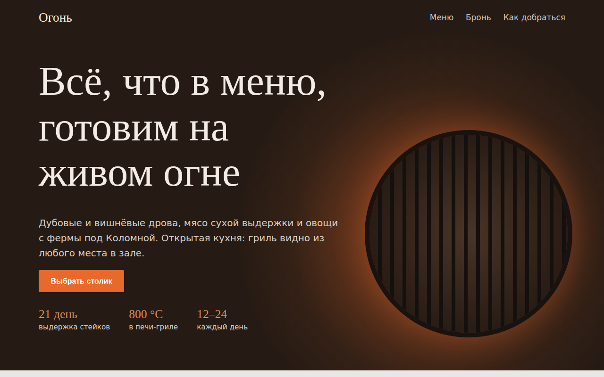

# Огонь: гриль-ресторан

Одностраничный сайт гриль-ресторана с меню и бронированием столика прямо на SVG-схеме зала. Свободные столики подсвечиваются под выбранные дату, время и число гостей.



## Возможности

**Меню**
- Пять вкладок: гриль, закуски, салаты, десерты, бар
- У блюда цена, выход, описание и отметки «Хит» и «Новинка»

**Бронирование**
- Дата на 14 дней вперёд (сегодня, завтра, дальше по дням недели), время с 12:00 до 22:30 с шагом 30 минут
- Прошедшие слоты на сегодня скрываются, если их не осталось, это видно в списке
- Схема зала из 14 столиков на 2, 4, 6 и 8 мест с открытой кухней и входом
- Четыре состояния столика: свободен, ваш выбор, занят (пунктир), мало мест для компании
- Выбор мышью или с клавиатуры (Tab, Enter, пробел), повторное нажатие снимает выбор
- Кнопка отправки неактивна, пока столик не выбран
- Маска телефона, проверка имени и телефона, подтверждение с деталями брони

**Оформление**
- Свечение огня и решётка гриля в первом экране сделаны на CSS-градиентах без картинок

## Стек

HTML5, CSS3, JavaScript без библиотек, inline SVG, шрифты Prata и IBM Plex Sans из Google Fonts.

## Как запустить

Сборка не нужна: откройте `index.html` в браузере.

Или через локальный сервер:

```bash
python -m http.server 8000
# затем http://localhost:8000
```

## Настройка

- Меню: объект `MENU` в скрипте `index.html`, у каждого блюда `[название, выход, цена, описание, отметка]`
- Столики: массив `TABLES` (`[номер, x, y, мест, форма]`, форма `c` круглая, `r` прямоугольная)
- Часы бронирования: цикл в `fillTimes()`

## Структура проекта

```
index.html    # вёрстка, стили и скрипт в одном файле
```

## Как это устроено

- Занятость столика считается хешем от даты, времени и номера столика: результат стабилен при перерисовке и выглядит правдоподобно без сервера
- Схема перерисовывается целиком при каждом изменении даты, времени или числа гостей, выбор при этом сбрасывается
- Ширина прямоугольного столика зависит от числа мест, двухместные рисуются кругами
- Каждый столик это `<g role="button">` с `aria-pressed` и `aria-label` («Столик 5, мест 6, занят»), недоступные столики убраны из порядка Tab
- `prefers-reduced-motion` отключает плавную прокрутку и переходы, до 860 px меню и форма в одну колонку

## Идеи для развития

- Реальная занятость столиков из API вместо хеша
- Бронь банкетного зала и предзаказ блюд
- Напоминание о брони по SMS

## Лицензия

Концепт-сайт, реального бизнеса за ним нет.

MIT © 2026 whysafe. Telegram: [@yawhysafe](https://t.me/yawhysafe) · Сайт: [whysafe.ru](https://whysafe.ru)
